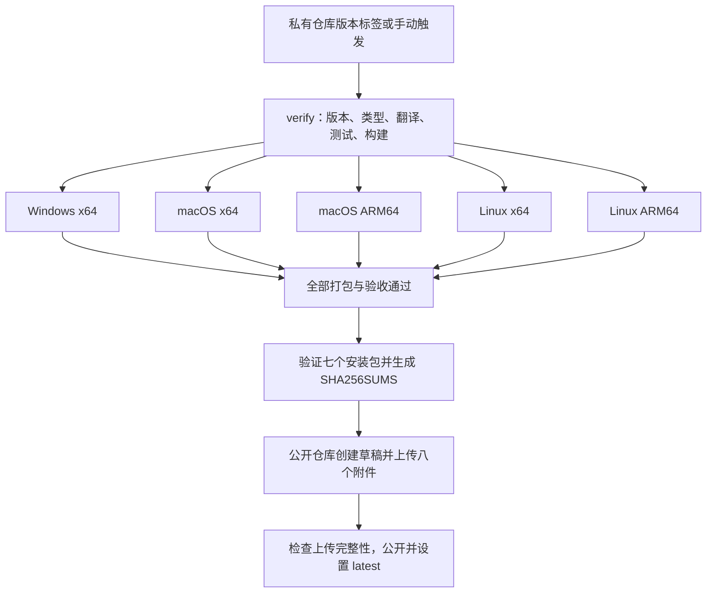

# Hornet Remote Suite 编译、打包与发布操作指南

更新日期：2026-10-16。本文依据当前仓库脚本编写，版本以 `src/package.json` 为准。示例中的 `0.0.4` 用于演示操作，正式发布必须使用尚未公开且与源码提交一致的新版本。

## 1. 仓库与发布范围

| 用途 | 仓库 | 内容 |
| --- | --- | --- |
| 私有源码 | `codehubcloud/hornet-remote-suite` | 源码、设计文档、测试、构建脚本、Actions 工作流 |
| 公开下载 | `codehubcloud/hornet-remote-suite-release` | 下载 README、Release 说明、安装包、SHA256SUMS |

版本从 `0.0.1` 开始，采用稳定的 `主版本.次版本.修订版本` 格式，例如 `0.0.4`，发布标签为 `v0.0.4`。当前脚本不接受预发布版本、前导零或额外空白。

私有仓库的标签触发实际构建；公开仓库的 Release 标签指向公开仓库自身的提交。公开 Release 中 GitHub 自动生成的 Source code 归档来自公开仓库，不包含私有项目源码。

安装包包含编译后的 JavaScript 和必要依赖，排除项目 TS/TSX、source map、设计文档和测试。ASAR 是打包格式，编译后的 JavaScript 仍可被提取，不应把它作为源码加密。

## 2. 入口文件

| 文件 | 作用 |
| --- | --- |
| [src/package.json](../src/package.json) | 版本、依赖和 npm 命令 |
| [src/package-lock.json](../src/package-lock.json) | 锁定依赖及应用版本 |
| [src/tools/build.mjs](../src/tools/build.mjs) | 编译主进程、preload、后台服务、界面及 Windows 原生辅助程序 |
| [src/electron-builder.cjs](../src/electron-builder.cjs) | 安装包格式、运行文件和解包配置 |
| [src/tools/verify-native.cjs](../src/tools/verify-native.cjs) | 在目标 Electron 中验证原生适配器 |
| [src/tools/audit-package.cjs](../src/tools/audit-package.cjs) | 检查包内文件范围和必要运行文件 |
| [.github/workflows/release.yml](../.github/workflows/release.yml) | 检查、五平台构建、打包验收和跨仓库发布 |
| [src/tools/check-release-version.mjs](../src/tools/check-release-version.mjs) | 核对请求版本与 package.json，确认 Actions 来源是私有仓库 |
| [src/tools/release-assets.mjs](../src/tools/release-assets.mjs) | 验证完整七安装包集合并生成 SHA256SUMS |
| [src/tools/publish-release.mjs](../src/tools/publish-release.mjs) | 创建草稿、上传附件、检查完整性后公开发布 |
| [src/release-notes.md](../src/release-notes.md) | 直接作为公开 Release 正文 |
| [src/VALIDATION.md](../src/VALIDATION.md) | 历史验证结果和发布记录 |

## 3. 编译环境

- 使用 Node.js `24.x`，项目要求 `>=24 <25`；Actions 当前固定 `24.21.0`。Electron、electron-builder 及其他依赖版本由 lockfile 决定。
- 在 `src` 目录执行 npm 命令，使用 `npm ci` 安装锁定依赖。
- Windows 原生辅助程序由系统 `.NET Framework64/v4.0.30319/csc.exe` 编译，须确保该编译器存在。
- 必须在与目标一致的操作系统和 CPU 架构上安装依赖并打包。`verify-native.cjs` 会拒绝不匹配的构建；不能在 Windows 上直接完成 macOS/Linux 发布包。
- Linux 打包及无界面验收所需依赖见工作流的安装步骤：`libarchive-tools`、`libfuse2`、`libgtk-3-0`、`libnss3`、`libasound2-dev`、`xvfb`。
- 首次安装和打包需要能访问 npm、Electron 及打包工具下载源。不要跨平台复制已安装的 `node_modules`。

Windows PowerShell 中使用 `npm.cmd` 和 `npx.cmd`，避免被 PowerShell 的 `.ps1` 执行策略阻止。如果使用仓库本机的便携 Node，可在仓库根目录执行：

```powershell
$env:Path = (Resolve-Path '.tools/node-v24.21.0-win-x64').Path + ';' + $env:Path
node --version
npm.cmd --version
Set-Location src
```

`.tools` 是本机忽略目录，其他开发机不一定存在该路径；已有符合要求的 Node 时，直接进入 `src` 即可。

## 4. 本地编译与运行

以下 PowerShell 命令的工作目录为 `src`：

```powershell
npm.cmd ci
npm.cmd run check
npm.cmd run test:release
npm.cmd start
```

`check` 依次执行类型检查、翻译资源检查、Vitest 测试和普通构建。`start` 启动已有构建；修改代码后可使用 `npm.cmd run dev` 重新构建并启动。

普通构建输出在 `src/dist/`：

| 产物 | 用途 |
| --- | --- |
| `main.cjs` | Electron 主进程 |
| `preload.cjs` | 沙箱 preload |
| `host.cjs` | 后台协议服务 |
| `schema.sql` | 使用 LF 换行的数据库结构文件 |
| `renderer/` | 界面 HTML、CSS 和 JavaScript |
| `NativeHost.exe` | Windows 原生辅助程序，仅 Windows 构建生成 |

普通构建保留 Node 侧 source map；`build:release` 使用压缩且不生成这些 source map。两个模式都会从 package.json 注入界面版本。单独复制 `dist` 不能替代完整安装包。

## 5. 本地打包与验收

### 5.1 Windows x64

在 `src` 下执行：

```powershell
npm.cmd run package
npm.cmd run test:package
$env:HORNET_SMOKE_SCHEMA_EOL = 'crlf'
try {
    npm.cmd run test:package
} finally {
    Remove-Item Env:HORNET_SMOKE_SCHEMA_EOL -ErrorAction SilentlyContinue
}
npm.cmd run test:clipboard:package
npm.cmd run test:transfer-reliability:package
npm.cmd run test:shutdown:package
npm.cmd run test:titlebar:package
npm.cmd run test:xshell-workspace:package
npm.cmd run test:help:package
```

`package` 先执行 `build:release`，再使用 electron-builder 构建 NSIS EXE；`--publish never` 禁止打包工具自行发布。只想检查解包后的应用时，使用 `npm.cmd run package:dir`，不会生成安装程序。

默认输出包括 `release/win-unpacked/Hornet Remote Suite.exe` 和 `release/Hornet-Remote-Suite-<版本>-windows-x64.exe`。NSIS 支持选择安装目录及创建快捷方式，配置中不删除用户应用数据。

### 5.2 macOS 和 Linux

在目标系统和目标架构的 `src` 目录中先执行：

```sh
npm ci
npm run check
npm run test:release
npm run build:release
```

然后按本机系统和架构选择一条打包命令：

| 目标 | 命令 |
| --- | --- |
| macOS Intel | `npx --no-install electron-builder --config electron-builder.cjs --mac --x64 --publish never` |
| macOS Apple Silicon | `npx --no-install electron-builder --config electron-builder.cjs --mac --arm64 --publish never` |
| Linux x64 | `npx --no-install electron-builder --config electron-builder.cjs --linux --x64 --publish never` |
| Linux ARM64 | `npx --no-install electron-builder --config electron-builder.cjs --linux --arm64 --publish never` |

macOS 打包前设置 `export CSC_IDENTITY_AUTO_DISCOVERY=false`，与当前未配置签名的工作流一致。macOS 验收：

```sh
npm run test:package
HORNET_SMOKE_SCHEMA_EOL=crlf npm run test:package
npm run test:clipboard:package
npm run test:transfer-reliability:package
npm run test:shutdown:package
npm run test:titlebar:package
npm run test:terminal-tabs:package
npm run test:xshell-workspace:package
npm run test:help:package
```

Linux 安装工作流列出的系统依赖后，用 Xvfb 执行验收：

```sh
xvfb-run -a npm run test:package
HORNET_SMOKE_SCHEMA_EOL=crlf xvfb-run -a npm run test:package
xvfb-run -a npm run test:clipboard:package
xvfb-run -a npm run test:transfer-reliability:package
xvfb-run -a npm run test:shutdown:package
xvfb-run -a npm run test:titlebar:package
xvfb-run -a npm run test:terminal-tabs:package
xvfb-run -a npm run test:xshell-workspace:package
xvfb-run -a npm run test:help:package
```

macOS 解包目录为 `release/mac/` 或 `release/mac-arm64/`，Linux 为 `release/linux-unpacked/` 或 `release/linux-arm64-unpacked/`。测试脚本按本机架构选择程序；使用自定义输出目录时，将 `HORNET_PACKAGED_EXECUTABLE` 设置为实际可执行文件的绝对路径。

### 5.3 验收覆盖与边界

`test:package` 启动真实打包程序，在临时目录注入历史 LF/CRLF 数据库，验证既有连接保留、应用版本、沙箱 preload、后台服务及回环 SSH/SFTP；Windows 另外验证原生辅助程序和 ConPTY。

`test:clipboard:package` 在真实打包程序中验证异步剪贴板 IPC、连续复制/粘贴顺序、鼠标选区、右键内容菜单、分屏目标、键盘操作、多行取消、长度限制、写入失败恢复和已关闭会话保护。它使用异步剪贴板替身，不读写用户真实系统剪贴板。

`test:transfer-reliability:package` 验证远端完整 SHA-256、上传校验零回读、单次下载、任务校验进度、计算哈希期间 X11 状态查询仍可响应及电源事件处理。心跳超时、模拟长时间休眠、SFTP 错误处理和远端命令不支持时的回退另由单元/集成测试覆盖；不以这些夹具结果代替真实 GB 级文件性能基准。

`test:shutdown:package` 在独立测试进程中阻断后台请求和 shutdown 的传递，并故意卡住测试 renderer，确认关闭提示无需等后台、取消保留应用、确认退出后清理等待有限且后台进程被结束。不在用户实际应用中注入故障；发布流程在每个平台执行此验收。

`test:titlebar:package` 检查透明 Logo、顶端合并菜单、主题与原生窗口按钮配色、拖动区域与菜单可点击区域、窄窗口安全布局及折叠行为。Windows/macOS 同时验证最大化、还原、最小化；Linux 无窗口管理器的 Xvfb 环境只验证窗口尺寸调整与菜单。全部使用临时用户目录。

`test:terminal-tabs:package` 验证分屏标签直接位于窗格顶部、没有全局终端标签与窗格标题重复；覆盖两种方向、重命名、分隔条、文件栏显隐、目录跟随、工作台往返及合并/关闭，检查终端 DOM 实例与远端 Shell 不被重建。五个平台均在实际打包程序中执行。

`test:xshell-workspace:package` 检查工具栏显隐/恢复/排序、快速命令配色及导入导出、每会话属性与底部说明、当前终端定向发送和异常断线自动重连。`test:help:package` 检查 F1 离线帮助、真实 PDF 生成、固定对外链接、新版/当前版本/网络失败重试和真实版本信息。浏览器与 PDF 查看器打开动作使用测试替身，不操作用户真实应用；更新服务器响应由夹具提供。Linux Xvfb 中显示隔离测试窗口以便捕获 compositor 帧。

这些测试使用临时数据和本机回环服务，不连接用户保存的远端主机。它们不能替代安装/卸载、真实远端协议、串口硬件、实体打印机或签名/公证验收；必要的人工安装验收应另行记录。

## 6. 自动发布准备

### 6.1 配置公开仓库和令牌

公开仓库须已存在且为 public，默认分支应有下载 README。发布脚本固定写入 `codehubcloud/hornet-remote-suite-release`。

在**私有源码仓库**的 `Settings → Secrets and variables → Actions` 配置仓库 secret `RELEASE_TOKEN`。令牌需要具备向公开下载仓库创建 Release 和上传附件的权限；现有发布说明建议使用仅访问该仓库、具有 Contents write 权限的 fine-grained PAT。默认工作流的 `GITHUB_TOKEN` 不承担跨仓库发布。

不要把令牌写入源码、文档、命令示例或日志。当前工作流仅在 publish 步骤注入 `RELEASE_TOKEN`；打包阶段使用 `--publish never`，不会自动上传安装包。

### 6.2 更新版本和发布说明

示例：从已发布 `0.0.3` 升级到新版本 `0.0.4`。在 `src` 下执行：

```powershell
npm.cmd version 0.0.4 --no-git-tag-version
node tools/check-release-version.mjs
npm.cmd run check
npm.cmd run test:release
```

`npm version` 同步更新 package.json 和 package-lock.json 的版本，不自动创建 Git 标签。更新 `src/release-notes.md`，明确本版本改动、验证和平台范围；它会原样成为公开 Release 正文，不应包含令牌、私有环境地址或用户数据。

如果还要通过 Actions 手动发布，可同步修改工作流 `workflow_dispatch.inputs.version.default` 作为表单默认值；该默认值不影响标签发布，手动输入仍必须与构建提交的 package.json 完全一致。

### 6.3 提交并推送标签

以下命令的工作目录为仓库根目录。先检查并提交本次需要发布的代码、版本、测试和 release notes；示例只列出版本相关文件，其他实现文件按实际变更加入暂存区。

```powershell
git status --short
git diff --check
git add src/package.json src/package-lock.json src/release-notes.md
git commit -m "release: prepare 0.0.4"
git push origin master
git tag v0.0.4
git push origin v0.0.4
```

标签必须指向本次完整实现的提交。推送 `v*` 标签会触发工作流；只推送 master 不会自动发布。

也可在私有仓库 Actions 中选择 `Build and publish binary installers`，手动运行，选择包含目标版本的分支或标签，并输入不带 `v` 的版本，例如 `0.0.4`。**标签触发和手动触发选择一种即可**，不要对同一版本重复发起发布。

## 7. Actions 流程



| 阶段 | 当前行为 |
| --- | --- |
| verify | Windows runner；检查私有仓库及版本，执行 npm ci、check、test:release；超时 20 分钟 |
| build | 五个独立目标，各自 npm ci、正式构建、原生模块检查、安装包审计、LF/CRLF 升级测试、剪贴板测试、传输可靠性及无响应退出测试；每任务超时 30 分钟 |
| artifact | 只收集根输出目录中的 EXE、DMG、AppImage、DEB；私有 Actions 内保留 7 天 |
| publish | 需要 verify 和全部 build 成功；合并安装包附件，调用 publish-release.mjs；超时 15 分钟 |

当前 runner 分别为 `windows-latest`、`macos-15-intel`、`macos-15`、`ubuntu-22.04`、`ubuntu-24.04-arm`。构建任务 `fail-fast: false`：一个平台失败不会取消其他平台，便于收集失败信息，但任何一个失败都会阻止发布。

工作流使用并发组避免相同触发键的任务互相覆盖，`cancel-in-progress: false`。同版本同时使用标签和手动触发可能进入不同并发组，因此仍须避免重复触发。

## 8. 发布附件和发布后检查

以 `0.0.4` 为例，发布脚本要求目录中精确包含以下七个非空安装包，可另外已有 SHA256SUMS：

```text
Hornet-Remote-Suite-0.0.4-windows-x64.exe
Hornet-Remote-Suite-0.0.4-macos-x64.dmg
Hornet-Remote-Suite-0.0.4-macos-arm64.dmg
Hornet-Remote-Suite-0.0.4-linux-x86_64.AppImage
Hornet-Remote-Suite-0.0.4-linux-arm64.AppImage
Hornet-Remote-Suite-0.0.4-linux-amd64.deb
Hornet-Remote-Suite-0.0.4-linux-arm64.deb
```

Linux x64 的 AppImage 文件名使用 `x86_64`，DEB 使用 `amd64`，不同于构建矩阵的 `x64`。发布目录中不得混入旧版本、源码压缩包、解包目录、blockmap 或其他文件。

如需对已经收集到本机的完整安装包集合单独检查，在 `src` 下执行：

```powershell
node tools/release-assets.mjs release-assets 0.0.4
```

`release-assets` 是示例收集目录，**不是** `release` 打包输出目录；后者通常还含解包程序和构建元数据，不能直接作为发布附件集合。上面的命令只生成 SHA256SUMS，不上传任何文件。正常发布优先使用 Actions，由其收集附件并注入 secret。

发布完成后核对：

1. 私有 Actions 中 verify、五个 build、publish 均成功。
2. 公开 Release 版本正确，不是 draft 或 prerelease，并被设置为 latest。
3. 附件总计八个：七个安装包和 SHA256SUMS；校验文件含七行，文件名对应本版本。
4. 从公开下载链接取得安装包并核对 SHA-256，完成所需的实际安装和启动验收。
5. 更新公开仓库 README 的最新版本和下载说明，在 `src/VALIDATION.md` 记录构建提交、Actions 链接、验收结果及限制。这两项文档更新没有自动完成，应分别提交。

Windows 校验命令：

```powershell
Get-FileHash './Hornet-Remote-Suite-0.0.4-windows-x64.exe' -Algorithm SHA256
```

在下载附件和 SHA256SUMS 的同一目录，macOS 使用 `shasum -a 256 -c SHA256SUMS`，Linux 使用 `sha256sum -c SHA256SUMS`。只下载其中一个平台时，检查对应那一行；完整校验命令会报告其余未下载文件缺失。

## 9. 失败重试、版本修复和排查

| 问题 | 处理方法 |
| --- | --- |
| 请求版本不匹配 | 对照触发标签/手动输入和构建提交中的 package.json，检查 lockfile 同步；不要只改手动输入绕过版本准备 |
| Actions 在启动前因账号付款或支出限额被拒绝 | 按 GitHub Billing 提示处理账号设置，不关闭测试。确需备用发布时，只使用已通过完整验收的原生平台产物，核对 artifact 摘要；复用产物必须证明应用代码、依赖和打包输入一致。Windows 本机须执行同一套实际包验收，并保留提交、产物、日志和校验记录；凑齐七个安装包后仍通过发布脚本的完整性检查 |
| 原生模块检查失败 | 确认本机 OS/CPU 与目标一致、使用 Node 24，并在该目标重新 npm ci；不要从其他系统复制依赖或禁用检查 |
| Windows NativeHost 编译失败 | 检查 build.mjs 使用的 Framework64 csc.exe 及系统 .NET 环境 |
| DEB 打包缺少元数据 | 检查 package.json 的 homepage 和打包配置的 maintainer，不移除当前必需字段 |
| 文件被占用 / EBUSY | 关闭使用本次构建输出的测试程序或解包应用，再打包；不要删除用户安装目录或用户数据来解决构建输出占用 |
| 安装包不完整或含额外文件 | 根据 expectedAssets 清单检查附件名和版本；所有七个目标齐全后才能发布 |
| GitHub 发布权限错误 | 检查私有仓库 RELEASE_TOKEN 是否配置、过期，以及其对公开仓库的发布权限；不要把令牌打印到日志 |
| 上传中断 | Release 保持草稿；原提交无需修改时可在同一个 Actions run 中重跑失败任务。发布脚本会删除草稿旧附件，再完整上传 |
| 版本已公开 | 流程拒绝覆盖；递增补丁版本，更新 lockfile 和 release notes，使用新标签。不要删除或移动已发布标签 |
| 安装后提示“后台服务退出” | 先检查具体启动原因及是否使用 0.0.2 或更新版本；保留数据库，确认 schema.sql 换行和历史 LF/CRLF 升级验收通过 |
| 复制/粘贴提示对象无法克隆 | 使用 0.0.3 或更新版本；检查主进程等待异步 clipboard 接口且运行了 test:clipboard:package |

重跑同一个失败 run 使用其原始提交，不会采用后续 master 修复。若需要修改代码，应以新提交重新构建；已公开的版本必须递增。未公开的标签调整属于人工处理，不是标准发布步骤，应先确认不存在已发布同版本附件和仍在运行的任务。

数据库升级只接受当前结构对应的 LF/CRLF 校验值；其他未知校验值应保留现场并排查，不删除或重建用户数据库。结构文件由 build.mjs 统一 LF，包内后台、schema.sql、原生辅助程序及依赖的真实文件位置由 electron-builder 配置和 audit-package 检查。

## 10. 当前发布边界

当前提供 Windows x64、macOS x64/ARM64、Linux x64/ARM64 安装包；尚未配置 Windows 商业签名及 Apple 签名/公证。新增签名时需另行配置凭据和验收，不能把当前流程标记为已签名发布。

原生 RDP、VcXsrv 管理、本地 PowerShell/CMD、串口及系统打印提交仍使用 Windows 适配器；跨平台安装包不代表这些功能已在其他系统实现。VcXsrv 不随安装包分发。协议、硬件和平台实际支持范围应随 release notes 和公开下载说明一起维护。
