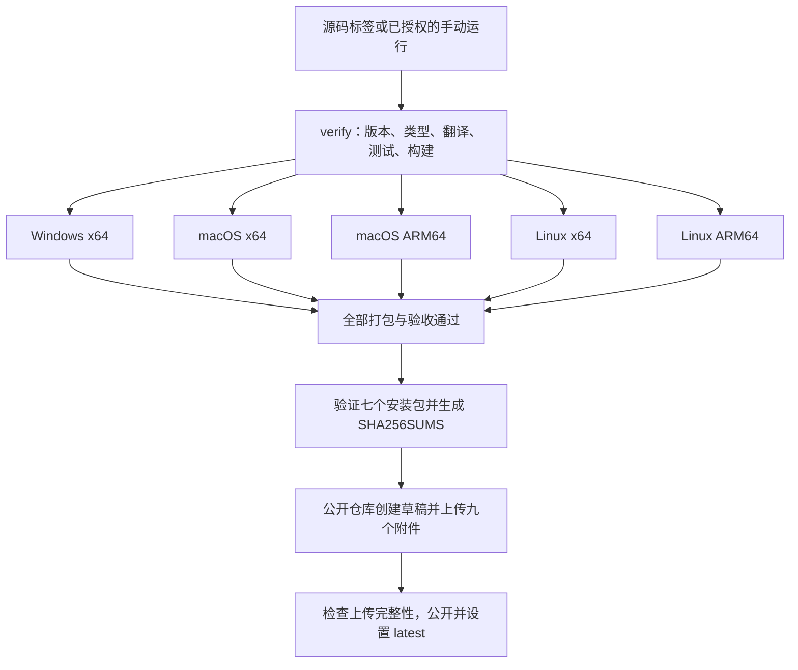

# Hornet Remote Suite 编译、打包与发布操作指南

更新日期：2026-10-25。本文依据当前仓库脚本编写；核对基线为已发布的 **0.0.35**，应用版本始终以 `src/package.json` 为准。后文 `0.0.36` 仅为下一版本的操作示例，执行前必须确认该版本尚未公开。仅修改文档不需要递增应用版本或触发发布。

本文中的“仓库根目录”指包含 `.github/`、`docs/` 和 `src/` 的目录；npm 命令均在 `src/` 执行，Git 提交及推送命令在仓库根目录执行。复制命令前先核对所在目录。

## 操作导航

| 需求 | 阅读位置 |
| --- | --- |
| Windows 本机生成安装包 | 第 3 章准备环境，第 5.1 节打包与验收 |
| 只运行开发版或调试修改 | 第 4 章 |
| 遇到 EBUSY、缺少 tsc/esbuild 或 Electron 下载失败 | 第 9 章 |
| 发布 Windows、macOS、Linux 完整安装包 | 第 6—8 章 |
| 源码仓库当前公开，如何触发发布 | 第 6.3 节：手动授权与标签触发的区别 |
| 检查发布是否真正完成、排查更新提示 | 第 8 章、第 11 章 |
| 记录本次发布的提交、产物和验收结果 | 第 12 章交接清单 |

## 1. 仓库与发布范围

| 用途 | 仓库 | 内容 |
| --- | --- | --- |
| 源码与构建 | `codehubcloud/hornet-remote-suite` | 源码、设计文档、测试、构建脚本、Actions 工作流；可见性与发布授权规则见第 6.3 节 |
| 公开下载 | `codehubcloud/hornet-remote-suite-release` | 下载 README、Release 说明、安装包、SHA256SUMS |

版本从 `0.0.1` 开始，采用稳定的 `主版本.次版本.修订版本` 格式，例如 `0.0.36`，发布标签为 `v0.0.36`。当前脚本不接受预发布版本、前导零或额外空白。

源码仓库负责实际构建，下载仓库负责公开 Release；两个仓库的同名版本标签不指向同一个 Git 对象。下载仓库的 Release 标签指向下载仓库自身的提交，GitHub 自动生成的 Source code 归档也来自该仓库，不包含本项目源码。源码仓库若被设为 public，其源码及可公开访问的构建信息仍按该仓库可见性开放；发布到另一个仓库不会隐藏源码。

标准发布要求五个目标构建全部通过、七个安装包齐全。仅完成本地 Windows 打包属于本地交付，不等于完成全平台发布；不要把一个 EXE 直接作为该版本的完整公开发布。

安装包包含编译后的 JavaScript 和必要依赖，排除项目 TS/TSX、source map、设计文档和测试。ASAR 是打包格式，编译后的 JavaScript 仍可被提取，不应把它作为源码加密。

## 2. 入口文件

| 文件 | 作用 |
| --- | --- |
| [src/package.json](../src/package.json) | 版本、依赖和 npm 命令 |
| [src/package-lock.json](../src/package-lock.json) | 锁定依赖及应用版本 |
| [start.cmd](../start.cmd) / [src/run.ps1](../src/run.ps1) | Windows 开发启动及检查入口；不生成安装包 |
| [src/tools/build.mjs](../src/tools/build.mjs) | 编译主进程、preload、后台服务、界面及 Windows 原生辅助程序 |
| [src/electron-builder.cjs](../src/electron-builder.cjs) | 安装包格式、运行文件和解包配置 |
| [src/build/installer.nsh](../src/build/installer.nsh) | Windows 安装时检测、确认关闭运行中的应用及成功后自动重开 |
| [src/build/installer-processes.ps1](../src/build/installer-processes.ps1) | 按安装记录、完整路径及产品信息识别旧目录或解压目录中运行的程序 |
| [src/build/installer-files-in-use.ps1](../src/build/installer-files-in-use.ps1) | Windows“正在使用的文件”原生对话框、程序列表和安装选项 |
| [src/build/installer-files-in-use.json](../src/build/installer-files-in-use.json) | 安装占用提示及延后安装提示的八种语言文案 |
| [src/tools/installer-smoke.ps1](../src/tools/installer-smoke.ps1) | 使用独立模拟应用验证实际 NSIS 安装流程 |
| [src/tools/verify-native.cjs](../src/tools/verify-native.cjs) | 在目标 Electron 中验证原生适配器 |
| [src/tools/audit-package.cjs](../src/tools/audit-package.cjs) | 检查包内文件范围和必要运行文件 |
| [.github/workflows/release.yml](../.github/workflows/release.yml) | 检查、五平台构建、打包验收和跨仓库发布 |
| [src/tools/check-release-version.mjs](../src/tools/check-release-version.mjs) | 核对请求版本、发布说明与 package.json，检查源码仓库可见性及公开运行授权 |
| [src/tools/release-notes.mjs](../src/tools/release-notes.mjs) | 校验八语发布说明、版本和 UTF-8 大小，提取英文公开正文 |
| [src/tools/release-assets.mjs](../src/tools/release-assets.mjs) | 验证完整七安装包集合并生成 SHA256SUMS |
| [src/tools/publish-release.mjs](../src/tools/publish-release.mjs) | 创建草稿、上传附件、检查完整性后公开发布 |
| [src/release-notes.json](../src/release-notes.json) | 八种语言的发布说明附件；公开正文使用纯英文以兼容旧客户端 |
| [src/VALIDATION.md](../src/VALIDATION.md) | 历史验证结果和发布记录 |

## 3. 编译环境

- 安装 Git，并确认能够拉取源码、向目标分支推送。当前 origin 使用 SSH；新机器可按自己的凭据选择 SSH 或 HTTPS，不在远程 URL 内嵌令牌。
- 使用 Node.js `24.x`，项目要求 `>=24 <25`；Actions 当前固定 `24.21.0`。Electron、electron-builder 及其他依赖版本由 lockfile 决定。
- 在 `src` 目录执行 npm 命令，使用 `npm ci` 安装锁定依赖。
- Windows 原生辅助程序由系统 `.NET Framework64/v4.0.30319/csc.exe` 编译，须确保该编译器存在。
- 必须在与目标一致的操作系统和 CPU 架构上安装依赖并打包。`verify-native.cjs` 会拒绝不匹配的构建；不能在 Windows 上直接完成 macOS/Linux 发布包。
- Linux 打包及无界面验收所需依赖见工作流的安装步骤：`libarchive-tools`、`libfuse2`、`libgtk-3-0`、`libnss3`、`libasound2-dev`、`xvfb`。
- 首次安装和打包需要能访问 npm、Electron 及打包工具下载源。不要跨平台复制已安装的 `node_modules`。

重新执行 `npm ci` 前，先退出从本仓库启动的 Hornet、Electron 测试和调试进程。若 `default_app.asar` 仍被占用，VS Code 的辅助进程或 ASAR 查看扩展也可能持有文件；完全退出 VS Code 后，从独立 PowerShell 窗口重试。`npm ci` 会先清理旧依赖，中断后即使 `node_modules` 目录还存在，依赖也可能已不完整。

Windows PowerShell 中使用 `npm.cmd` 和 `npx.cmd`，避免被 PowerShell 的 `.ps1` 执行策略阻止。如果使用仓库本机的便携 Node，可在仓库根目录执行：

```powershell
$env:Path = (Resolve-Path '.tools/node-v24.21.0-win-x64').Path + ';' + $env:Path
node --version
npm.cmd --version
Set-Location src
```

`.tools` 是本机忽略目录，其他开发机不一定存在该路径；已有符合要求的 Node 时，直接进入 `src` 即可。

在当前机器从一个全新 PowerShell 窗口开始，可先执行以下环境检查：

```powershell
Set-Location -LiteralPath 'D:\Software\Microsoft\code\hornet_remote_suite'
git status --short
git branch --show-current
git remote -v
$env:Path = (Resolve-Path '.tools/node-v24.21.0-win-x64').Path + ';' + $env:Path
node --version
npm.cmd --version
Set-Location src
node -p "process.platform + ' / ' + process.arch"
node -p "require('./package.json').version"
Test-Path "$env:WINDIR\Microsoft.NET\Framework64\v4.0.30319\csc.exe"
```

此机器通常应显示 `v24.21.0`、`win32 / x64`，最后一项为 `True`。其他机器替换项目路径，并使用本机安装的 Node。仓库 `package.json` 中的 `private: true` 用于阻止误发布 npm 包，**不表示 GitHub 仓库已设为私有**。

安装依赖须包含 devDependencies；不要设置 `NODE_ENV=production` 或使用 `npm ci --omit=dev` 后执行构建。TypeScript、esbuild、Electron、electron-builder 和 Playwright 均来自项目锁定的开发依赖。

## 4. 本地编译与运行

以下 PowerShell 命令的工作目录为 `src`：

```powershell
npm.cmd ci
if ($LASTEXITCODE -ne 0) { throw '依赖安装失败，停止编译；先解决文件占用或网络错误，再重新执行 npm ci。' }
npm.cmd run prepare:runtime
if ($LASTEXITCODE -ne 0) { throw 'Electron 运行时准备失败，检查下载网络后重试。' }
npm.cmd run check
if ($LASTEXITCODE -ne 0) { throw '源码检查失败，停止打包。' }
npm.cmd run test:release
if ($LASTEXITCODE -ne 0) { throw '发布配置检查失败，停止运行。' }
npm.cmd start
```

`check` 依次执行类型检查、翻译资源检查、Vitest 测试和普通构建。`start` 启动已有构建；修改代码后可使用 `npm.cmd run dev` 重新构建并启动。

Windows 还可在仓库根目录双击 `start.cmd`，或使用下列已入库入口：

```powershell
powershell.exe -NoProfile -ExecutionPolicy Bypass -File .\src\run.ps1 -Action start
```

`run.ps1` 支持 `start`、`check`、`build`、`test`、`desktop-test`；默认 `start` 会先构建再启动，脚本临时选择便携 Node，并在结束后恢复工作目录和 PATH。它不会自动安装依赖。当前仓库没有 `run.py`，不要依赖旧 IDE 标签中的 Python 启动入口。

| 命令（在 src 下） | 输出与用途 | 是否生成安装器 / 发布 |
| --- | --- | --- |
| `npm.cmd run build` | 普通编译，输出 dist | 否 / 否 |
| `npm.cmd start` | 运行已有 dist | 否 / 否 |
| `npm.cmd run dev` | 普通编译后启动桌面应用；不是热更新服务 | 否 / 否 |
| `npm.cmd run check` | 类型、语言、单元/集成测试及普通编译 | 否 / 否 |
| `npm.cmd run build:release` | 压缩正式运行产物，输出 dist | 否 / 否 |
| `npm.cmd run package:dir` | 准备运行时、正式编译、生成解包目录 | 否 / 否 |
| `npm.cmd run package` | 准备运行时、正式编译、本机平台安装包 | 是 / 否 |
| `npm.cmd run test:package` | 验证已有解包程序；不会重新构建 | 否 / 否 |

启动器会去掉继承的 `ELECTRON_RUN_AS_NODE`，避免 Electron 以 Node 模式运行。原生适配器检查内部会有意使用该变量；不要为规避检查修改其脚本。

普通构建输出在 `src/dist/`：

| 产物 | 用途 |
| --- | --- |
| `main.cjs` | Electron 主进程 |
| `preload.cjs` | 沙箱 preload |
| `host.cjs` | 后台协议服务 |
| `schema.sql` | 使用 LF 换行的数据库结构文件 |
| `renderer/` | 界面 HTML、CSS 和 JavaScript |
| `NativeHost.exe` | Windows 原生辅助程序，仅 Windows 构建生成 |

普通构建保留 Node 侧 source map；`build:release` 使用压缩且不生成这些 source map。两个模式都会从 package.json 注入界面版本。单独复制 `dist` 不能替代完整安装包。

## 5. 本地打包与验收

### 5.1 Windows x64

在 `src` 下执行：

```powershell
function Invoke-HornetScript {
    param([Parameter(Mandatory)][string]$Name)
    & npm.cmd run $Name
    if ($LASTEXITCODE -ne 0) { throw "npm run $Name 失败，停止后续步骤。" }
}

# 已完成第 4 章的 npm ci；先检查源码，再构建本机安装包。
Invoke-HornetScript check
Invoke-HornetScript 'test:release'
Invoke-HornetScript package
Invoke-HornetScript 'test:package'
$env:HORNET_SMOKE_SCHEMA_EOL = 'crlf'
try {
    Invoke-HornetScript 'test:package'
} finally {
    Remove-Item Env:HORNET_SMOKE_SCHEMA_EOL -ErrorAction SilentlyContinue
}

# 对齐工作流的实际包功能验收；每项失败即停止。
$packagedChecks = @(
    'test:clipboard:package',
    'test:terminal-tabs:package',
    'test:titlebar:package',
    'test:terminal-disconnect:package',
    'test:session-tabs:package',
    'test:profile-password:package',
    'test:xshell-workspace:package',
    'test:help:package',
    'test:transfer-reliability:package',
    'test:shutdown:package',
    'test:advanced-menus:package'
)
foreach ($script in $packagedChecks) { Invoke-HornetScript $script }
```

`package` 先执行 `prepare:runtime` 确保锁定版本的 Electron 运行时存在，再执行 `build:release`，最后使用 electron-builder 构建 NSIS EXE；`--publish never` 禁止打包工具自行发布。运行时已安装时不会重复下载；安装器按 Electron 包内置的校验摘要验证下载。只想检查解包后的应用时，使用 `npm.cmd run package:dir`，不会生成安装程序。

PowerShell 5.1 不会因为外部命令返回非零退出码自动停止后续命令，设置 `$ErrorActionPreference = 'Stop'` 也不能替代上面的 `$LASTEXITCODE` 检查。某一步失败后，应先解决该错误，不要继续执行打包或验收。

默认输出包括 `release/win-unpacked/Hornet Remote Suite.exe` 和 `release/Hornet-Remote-Suite-<版本>-windows-x64.exe`。NSIS 支持选择安装目录及创建快捷方式，配置中不删除用户应用数据。

交付给用户的是带版本号的 EXE 安装程序；`win-unpacked` 用于运行与验收，不是单文件便携版。`test:package` 检查解包应用，不能代替安装器行为验收。Windows 本机补充运行与 verify 阶段相同的真实服务及安装器测试：

```powershell
# 沿用上面定义的 Invoke-HornetScript；在 Windows 交互桌面执行。
foreach ($script in @('test:file-drag', 'test:session-confirm', 'test:file-transfers', 'test:installer')) {
    Invoke-HornetScript $script
}

$version = (Get-Content -Raw -Encoding UTF8 package.json | ConvertFrom-Json).version
$env:HORNET_PACKAGED_EXECUTABLE = (Resolve-Path 'release/win-unpacked/Hornet Remote Suite.exe').Path
$env:HORNET_INSTALLER_EXECUTABLE = (Resolve-Path "release/Hornet-Remote-Suite-$version-windows-x64.exe").Path
try {
    Invoke-HornetScript 'test:installer:startup'
} finally {
    Remove-Item Env:HORNET_PACKAGED_EXECUTABLE,Env:HORNET_INSTALLER_EXECUTABLE -ErrorAction SilentlyContinue
}
```

如果只需要尽快得到本机安装包，可完成 `npm ci → check → test:release → package → test:package` 后取出 EXE；这属于基础本机检查。正式全平台发布仍须通过工作流的完整验收，不能把省略的测试记录为通过。

若旧打包目录中的 `app.asar` 被占用，且暂时不便退出编辑器，可在 `src` 下为本次打包指定新的输出目录。对应的验收也须指向该目录，避免检查旧程序：

```powershell
$env:HORNET_PACKAGE_OUTPUT = '..\.tools\local-package'
try {
    npm.cmd run package
    if ($LASTEXITCODE -ne 0) { throw '打包失败。' }
    $env:HORNET_PACKAGED_EXECUTABLE = (Resolve-Path '..\.tools\local-package\win-unpacked\Hornet Remote Suite.exe').Path
    npm.cmd run test:package
    if ($LASTEXITCODE -ne 0) { throw '安装包验收失败。' }
} finally {
    Remove-Item Env:HORNET_PACKAGE_OUTPUT,Env:HORNET_PACKAGED_EXECUTABLE -ErrorAction SilentlyContinue
}
```

该示例的安装程序位于仓库根目录 `.tools/local-package/`；若该目录也有运行中的程序，应另选新的目录或先关闭对应进程。

#### Windows 安装时关闭与重开应用

安装器使用 `src/build/installer.nsh` 和 `src/build/installer-processes.ps1` 检测正在运行的应用。Hornet 正在运行时，打开安装器即显示“正在使用的文件”原生窗口，列出占用文件的程序、进程编号和路径，无需先点击“下一步”或“安装”。用户可以选择：

- **自动关闭应用程序，并在安装完成后重新打开**（默认）：点击确定后关闭对应程序，再继续安装；安装成功后自动重新打开一次，无需再点击完成页的运行选项。关闭应用会结束当前连接和传输，请先完成重要操作。
- **不关闭应用程序，保留安装包，稍后安装**：保留当前程序和连接，安装器退出时不要求重启电脑，也不登记 Windows 登录任务。软件内下载的安装包及校验记录保存在用户数据目录的 `updates` 文件夹；下次启动软件会提示可安装，再次点击“帮助 → 检查更新”也可直接点击“安装更新”，无需重新下载。独立运行的安装器另存到 `%LOCALAPPDATA%\Hornet Remote Suite\Installer\<应用 GUID>\pending.exe`，也可稍后手动运行。
- **取消**或关闭窗口：退出本次安装，保留原应用。

选择目录和安装模式后，在实际覆盖前再次检查，防止用户在安装期间又启动应用。对话框支持安装器的八种语言。目标目录及安装模式单独保存在 `HKCU\Software\<应用 GUID>\PendingInstall`，用于稍后手动恢复安装；缓存失败会提示错误，成功安装会清理待安装登记及旧版遗留的 `Run`/`RunOnce` 启动项。软件每次恢复或启动已下载的更新前，都会核对版本、平台、文件大小及 SHA-256；缺失或损坏的安装包需要重新下载，已安装版本不会再次提示。

应用原本未运行时，保留正常安装向导及完成页的“运行 Hornet Remote Suite”复选框，由用户选择是否启动。进程检测或关闭失败时提示重试或取消，不直接继续覆盖。静默 `/S` 安装遇到运行中的应用返回非零状态，不擅自关闭。安装目录通过环境变量传递，支持空格和单引号；检测覆盖目标目录及安装记录中的旧目录，目录外的同名程序还需匹配 Hornet 的产品名称和发布者信息，支持从解压目录运行的真实程序，不仅按文件名结束进程。

在 Windows 桌面会话中运行 `npm.cmd run test:installer` 可验证安装器生命周期。测试用小型模拟应用及独立 appId、临时目录，实际编译并操作 NSIS 安装器，覆盖未运行时的正常完成页、打开即提示、取消保护、静默拒绝、确认关闭和成功后自动重开；还覆盖延后安装的单选项、原程序保持运行、缓存完整性、不登记登录任务、不返回重启请求，以及稍后手动恢复安装后的自动重开与登记清理。测试也覆盖解压目录运行及更换安装目录，检查目录前缀相同但产品信息不同的另一个应用仍在运行。测试不重启电脑，不覆盖或修改用户安装的 Hornet，结束后卸载临时应用并清理其独立注册信息。

设置 `HORNET_PACKAGED_EXECUTABLE` 为实际打包程序、`HORNET_INSTALLER_EXECUTABLE` 为待测安装包后，运行 `npm.cmd run test:installer:startup` 可验证真实 Electron 与生产安装器：使用隔离数据启动程序，打开指向另一临时目录的安装器，不点击下一步/安装，检查关闭提示并只点击取消，确认原程序仍运行且没有安装新文件。此验证不会确认关闭或覆盖用户安装的程序。

### 5.2 macOS 和 Linux

在目标系统和目标架构的 `src` 目录中先执行：

```sh
set -e
npm ci
npm run prepare:runtime
npm run check
npm run test:release
npm run build:release
```

然后按本机系统和架构选择一条打包命令：

| 目标 | 命令 |
| --- | --- |
| macOS Intel | `npx --no-install electron-builder --config electron-builder.cjs --mac --x64 --publish never` |
| macOS Apple Silicon | `npx --no-install electron-builder --config electron-builder.cjs --mac --arm64 --publish never` |
| Linux x64 | `npx --no-install electron-builder --config electron-builder.cjs --linux --x64 --publish never` |
| Linux ARM64 | `npx --no-install electron-builder --config electron-builder.cjs --linux --arm64 --publish never` |

Linux 需要先在目标机器安装依赖；以下命令与当前 Ubuntu runner 配置一致，其他发行版须使用其对应的软件包名：

```sh
sudo apt-get update
sudo apt-get install -y libarchive-tools libfuse2 libgtk-3-0 libnss3 libasound2-dev xvfb
```

macOS 打包前设置 `export CSC_IDENTITY_AUTO_DISCOVERY=false`，与当前未配置签名的工作流一致。macOS 完整包验收：

```sh
set -e
npm run test:package
HORNET_SMOKE_SCHEMA_EOL=crlf npm run test:package
for check in clipboard terminal-tabs titlebar terminal-disconnect session-tabs profile-password xshell-workspace help transfer-reliability shutdown advanced-menus; do
  npm run "test:$check:package"
done
```

Linux 安装工作流列出的系统依赖后，用 Xvfb 执行验收：

```sh
set -e
xvfb-run -a npm run test:package
HORNET_SMOKE_SCHEMA_EOL=crlf xvfb-run -a npm run test:package
for check in clipboard terminal-tabs titlebar terminal-disconnect session-tabs profile-password xshell-workspace help transfer-reliability shutdown advanced-menus; do
  xvfb-run -a npm run "test:$check:package"
done
```

macOS 解包目录为 `release/mac/` 或 `release/mac-arm64/`，Linux 为 `release/linux-unpacked/` 或 `release/linux-arm64-unpacked/`。测试脚本按本机架构选择程序；使用自定义输出目录时，将 `HORNET_PACKAGED_EXECUTABLE` 设置为实际可执行文件的绝对路径。

例如 macOS ARM64 的实际入口是 `release/mac-arm64/Hornet Remote Suite.app/Contents/MacOS/Hornet Remote Suite`；Linux x64 是 `release/linux-unpacked/hornet-remote-suite`。`HORNET_PACKAGE_OUTPUT` 控制打包输出，`HORNET_PACKAGED_EXECUTABLE` 控制验收启动哪一个文件，两者必须配套设置。正常发布工作流固定收集 `src/release/`，本地自定义输出目录不会自动被其收集。

### 5.3 验收覆盖与边界

`test:package` 启动真实打包程序，在临时目录注入历史 LF/CRLF 数据库，验证既有连接保留、应用版本、沙箱 preload、后台服务及回环 SSH/SFTP；Windows 另外验证原生辅助程序和 ConPTY。

`test:clipboard:package` 在真实打包程序中验证异步剪贴板 IPC、连续复制/粘贴顺序、鼠标选区、右键内容菜单、分屏目标、键盘操作、多行取消、长度限制、写入失败恢复和已关闭会话保护。它使用异步剪贴板替身，不读写用户真实系统剪贴板。

`test:transfer-reliability:package` 验证远端完整 SHA-256、上传校验零回读、单次下载、任务校验进度、计算哈希期间 X11 状态查询仍可响应及电源事件处理。心跳超时、模拟长时间休眠、SFTP 错误处理和远端命令不支持时的回退另由单元/集成测试覆盖；不以这些夹具结果代替真实 GB 级文件性能基准。

`test:shutdown:package` 在独立测试进程中阻断后台请求和 shutdown 的传递，并故意卡住测试 renderer，确认关闭提示无需等后台、取消保留应用、确认退出后清理等待有限且后台进程被结束。不在用户实际应用中注入故障；发布流程在每个平台执行此验收。

`test:titlebar:package` 检查透明 Logo、顶端合并菜单、主题与原生窗口按钮配色、拖动区域与菜单可点击区域、窄窗口安全布局及折叠行为。Windows/macOS 同时验证最大化、还原、最小化；Linux 无窗口管理器的 Xvfb 环境只验证窗口尺寸调整与菜单。全部使用临时用户目录。

`test:terminal-tabs:package` 验证分屏标签直接位于窗格顶部、没有全局终端标签与窗格标题重复；覆盖两种方向、重命名、分隔条、文件栏显隐、目录跟随、工作台往返及合并/关闭，检查终端 DOM 实例与远端 Shell 不被重建。五个平台均在实际打包程序中执行。

| 补充验收 | 关键覆盖 |
| --- | --- |
| `test:file-drag` | 真实 SSH/SFTP 服务、首次识别远端系统图标、本地/远程拖拽传输 |
| `test:session-confirm` | 断开连接与关闭会话前的确认、取消保护及已断开状态 |
| `test:file-transfers` | 同名目标的覆盖/跳过/重命名、全部应用、底部进度及终端左侧任务布局；检查终端高度不被任务区域挤占 |
| `test:terminal-disconnect:package` | TCP 静默丢包、保活断线及终端恢复 |
| `test:session-tabs:package` | 标签操作、会话与通道复制区别、保存凭据后的重启登录 |
| `test:profile-password:package` | 已保存密码默认掩码、显式点击眼睛查看及编辑保存 |
| `test:advanced-menus:package` | 全屏与菜单状态同步、查找、十六进制浏览、打印预览及其他高级菜单操作 |

verify 阶段的前三项在开发构建上执行；带 `:package` 的项目在每个平台实际解包程序上执行。`npm run check` 不包含这些全部桌面验收，也不生成安装包。

`test:xshell-workspace:package` 检查工具栏显隐/恢复/排序、快速命令配色及导入导出、每会话属性与底部说明、当前终端定向发送和异常断线自动重连。`test:help:package` 检查 F1 离线帮助、真实 PDF 生成、固定对外链接、新版/当前版本/网络失败重试和真实版本信息。浏览器与 PDF 查看器打开动作使用测试替身，不操作用户真实应用；更新服务器响应由夹具提供。Linux Xvfb 中显示隔离测试窗口以便捕获 compositor 帧。

这些测试使用临时数据和本机回环服务，不连接用户保存的远端主机。它们不能替代安装/卸载、真实远端协议、串口硬件、实体打印机或签名/公证验收；必要的人工安装验收应另行记录。

## 6. 自动发布准备

### 6.1 配置公开仓库和令牌

公开仓库须已存在且为 public，默认分支应有下载 README。发布脚本固定写入 `codehubcloud/hornet-remote-suite-release`。

在**源码仓库**的 `Settings → Secrets and variables → Actions` 配置仓库 secret `RELEASE_TOKEN`。令牌需要具备向公开下载仓库创建 Release 和上传附件的权限；现有发布说明建议使用仅访问该仓库、具有 Contents write 权限的 fine-grained PAT。令牌的授权目标是下载仓库，secret 的存放位置是源码仓库，两者不要弄反。默认工作流仅有 `contents: read`，其 `GITHUB_TOKEN` 不承担跨仓库发布。

不要把令牌写入源码、文档、命令示例或日志。当前工作流仅在 publish 步骤注入 `RELEASE_TOKEN`；打包阶段使用 `--publish never`，不会自动上传安装包。

### 6.2 更新版本和发布说明

先确认目标版本尚未公开，源码修改已经完成，且没有同版本的发布任务正在运行。示例：从已发布 `0.0.35` 升级到新版本 `0.0.36`。在 `src` 下执行：

```powershell
npm.cmd version 0.0.36 --no-git-tag-version
if ($LASTEXITCODE -ne 0) { throw '修改版本失败。' }
```

`npm version` 同步更新 package.json、package-lock.json 顶层及根包版本，不自动创建 Git 标签。接着编辑 `src/release-notes.json`，将其 `version` 设为 `0.0.36`，并填写本版本八种语言内容（zh-CN、zh-TW、en、ja、ko、de、fr、es）。每种语言应说明同一组实际改动、验证和平台限制；不要用其他语言的旧说明填补缺项。示意结构如下，省略号须替换为实际内容：

```json
{
  "version": "0.0.36",
  "notes": {
    "zh-CN": "Hornet Remote Suite 0.0.36\n\n- …",
    "zh-TW": "Hornet Remote Suite 0.0.36\n\n- …",
    "en": "Hornet Remote Suite 0.0.36\n\n- …",
    "ja": "Hornet Remote Suite 0.0.36\n\n- …",
    "ko": "Hornet Remote Suite 0.0.36\n\n- …",
    "de": "Hornet Remote Suite 0.0.36\n\n- …",
    "fr": "Hornet Remote Suite 0.0.36\n\n- …",
    "es": "Hornet Remote Suite 0.0.36\n\n- …"
  }
}
```

说明使用 UTF-8。JSON 字符串内换行写为 `\n`；不要直接把带引号的多行文本粘进字符串。Windows PowerShell 编辑中文文件时使用明确的 UTF-8 编码；不要经系统默认编码转存，否则中文可能变成不可恢复的 `?`。

发布脚本的大小检查针对序列化 JSON；客户端还限制实际下载文件的字节数。因此带缩进的源文件本身也应不超过 65,536 字节，可用 `(Get-Item release-notes.json).Length` 检查，避免额外空白导致客户端拒绝读取。

版本检查和发布脚本会拒绝版本不一致、语言缺失、单语言超过 14,000 字符、包含 HTML 注释或序列化后超过 64 KiB 的内容。**公开 GitHub Release 正文仅使用 `notes.en` 的英文内容**，不要放 `<details>`、`<summary>`、语言标记或拼接所有翻译；旧客户端会直接显示这些代码。八语内容通过独立 `release-notes.json` 附件提供，新客户端读取后按软件设置语言显示。`src/release-notes.md` 可保留中文概要，但不是发布脚本的正文输入。说明不得包含令牌、私有环境地址或用户数据。

所有说明更新完成后，再在 `src` 执行：

```powershell
node tools/check-release-version.mjs
if ($LASTEXITCODE -ne 0) { throw '版本或八语发布说明检查失败。' }
npm.cmd run check
if ($LASTEXITCODE -ne 0) { throw '源码检查失败。' }
npm.cmd run test:release
if ($LASTEXITCODE -ne 0) { throw '发布配置测试失败。' }
```

本地版本检查通过只证明本地版本与说明符合规则；Actions 还会检查触发版本、仓库可见性及公开构建授权。

如果还要通过 Actions 手动发布，可同步修改工作流 `workflow_dispatch.inputs.version.default` 作为表单默认值；该默认值不影响标签发布，手动输入仍必须与构建提交的 package.json 完全一致。

### 6.3 提交源码并选择一种触发方式

以下命令的工作目录为仓库根目录。先检查并提交本次需要发布的代码、版本、测试和 release notes；示例只列出版本相关文件，其他实现文件按实际变更加入暂存区。

```powershell
git status --short
git diff --check
git add src/package.json src/package-lock.json src/release-notes.json src/release-notes.md
# 将本次实现、测试、工作流等实际改动也按文件路径加入暂存区。
git diff --cached --stat
git commit -m "release: prepare 0.0.36"
if ($LASTEXITCODE -ne 0) { throw '提交失败。' }
git push origin master
if ($LASTEXITCODE -ne 0) { throw '推送失败，停止触发发布。' }
git rev-parse HEAD
```

记录最后输出的完整提交 SHA，并确认未遗漏实现文件。只推送 `master` 不会自动发布。

#### A. 源码仓库为 private：版本标签触发

在上面的完整提交推送成功后，在仓库根目录执行：

```powershell
git tag v0.0.36
if ($LASTEXITCODE -ne 0) { throw '标签已存在或创建失败，先核对已有标签。' }
git push origin v0.0.36
if ($LASTEXITCODE -ne 0) { throw '标签推送失败。' }
git rev-parse v0.0.36
```

标签必须指向本次完整实现的提交。推送 `v*` 标签会触发工作流；后续 `master` 的变化不会进入该标签构建。

#### B. 源码仓库为 public：手动明确授权

源码仓库公开时，常规标签构建会被可见性检查拒绝。当前支持无需更改仓库可见性的手动授权路径：

1. 将准备好的源码、版本和说明提交并推送到 `master`。
2. 打开源码仓库的 [Actions 发布工作流](https://github.com/codehubcloud/hornet-remote-suite/actions/workflows/release.yml)。
3. 点击 **Run workflow**，选择包含该版本的分支，例如 `master`。
4. `version` 填 `0.0.36`，必须与所选提交的 `src/package.json` 完全一致，不带 `v`。
5. 将 `allow_public_source_release` 设为 **true**，再运行。
6. 打开新 run，核对其提交 SHA 与本次准备的提交一致，并保留链接。

手动运行使用所选 ref 当时的提交；不用再推送同版本源码标签触发第二个任务。公开下载仓库的 Release 标签仍由发布脚本创建。授权选项只允许本次从公开源码仓库发布，不会改变任何仓库可见性。

**当前保留的例外：** `.github/workflows/release.yml` 和 `src/tools/check-release-version.mjs` 同时明确允许公开源码仓库的 `refs/tags/v0.0.35` 标签构建；这是该版本的精确授权，不会自动覆盖 `v0.0.36` 或未来版本。未来若明确选择公开仓库的标签触发，需要在准备提交中同步更新这两个文件的精确标签/版本规则，并重新验收；优先使用上面的手动授权路径可避免修改此例外。仅修改其中一个文件、仅设置任意环境变量，或仅修改表单默认版本都不等于完成授权。

私有源码仓库也可以手动运行，公开授权选项可保持 false。**标签触发和手动触发选择一种即可**，不要对同一版本重复发起发布。仓库可见性调整属于独立管理操作，不是本指南要求的发布步骤；不要用脚本在发布过程中自动来回切换。

## 7. Actions 流程



| 阶段 | 当前行为 |
| --- | --- |
| verify | Windows runner；检查版本、发布说明及可见性授权，执行 npm ci、check、test:file-drag、test:session-confirm、test:file-transfers、test:release、test:installer；超时 20 分钟 |
| build | 五个独立目标，各自 npm ci、准备运行时、正式构建、原生模块检查、包审计、第 5 章完整包验收；Windows 另运行真实安装器启动占用提示测试；每任务超时 30 分钟 |
| artifact | 只收集根输出目录中的 EXE、DMG、AppImage、DEB；Actions 中间产物保留 7 天，压缩级别 0 |
| publish | 需要 verify 和全部 build 成功；合并安装包附件，调用 publish-release.mjs；超时 15 分钟 |

当前 runner 分别为 `windows-latest`、`macos-15-intel`、`macos-15`、`ubuntu-22.04`、`ubuntu-24.04-arm`。构建任务 `fail-fast: false`：一个平台失败不会取消其他平台，便于收集失败信息，但任何一个失败都会阻止发布。

| Actions 目标 | 上传 artifact 名称 | 预期安装包数 |
| --- | --- | --- |
| Windows x64 | `installers-win-x64` | 1：EXE |
| macOS Intel | `installers-mac-x64` | 1：DMG |
| macOS Apple Silicon | `installers-mac-arm64` | 1：DMG |
| Linux x64 | `installers-linux-x64` | 2：AppImage、DEB |
| Linux ARM64 | `installers-linux-arm64` | 2：AppImage、DEB |

`beforePack` 会在目标 Electron 中实际加载 `node-pty` 和 `serialport`，`afterPack` 审计包内容。不能通过关闭这些钩子、复制其他系统的 node_modules 或减少验收步骤来凑齐产物。Actions 缓存 npm 下载内容，不代表可以跳过每个平台的 `npm ci`。

工作流使用并发组避免相同触发键的任务互相覆盖，`cancel-in-progress: false`。同版本同时使用标签和手动触发可能进入不同并发组，因此仍须避免重复触发。

### 7.1 观察进度和重试

从源码仓库 **Actions → 对应 run** 查看任务图和每个 job 的当前步骤。verify 成功后才启动五个平台，全部成功后才启动 publish。排队、开始运行、上传 artifact 或创建 Release 草稿，都不表示公开发布已经完成。

某个平台失败时，打开其首个失败步骤查看原因，保存 run 链接、job 名称、提交 SHA 和关键错误；其他平台可以继续收集结果。若只是临时网络、下载或 runner 故障，且无需修改源码，待 run 完成后使用 **Re-run failed jobs**，保留成功平台的结果。若修改了源码或测试，旧 run 的重试仍然使用原提交，必须重新准备并触发构建，不能把新修改描述成已通过旧 run。

publish 失败时，先确认公开仓库是否已有本版本草稿，再看上传/权限错误。脚本只会清理并重传**同版本未公开草稿**的附件；已公开的稳定版会被拒绝覆盖。发布前不要手动公开只有部分附件的草稿，也不要为绕过失败删除测试步骤。

## 8. 发布附件和发布后检查

以 `0.0.36` 为例，发布脚本要求目录中精确包含以下七个非空安装包，可另外已有 SHA256SUMS：

```text
Hornet-Remote-Suite-0.0.36-windows-x64.exe
Hornet-Remote-Suite-0.0.36-macos-x64.dmg
Hornet-Remote-Suite-0.0.36-macos-arm64.dmg
Hornet-Remote-Suite-0.0.36-linux-x86_64.AppImage
Hornet-Remote-Suite-0.0.36-linux-arm64.AppImage
Hornet-Remote-Suite-0.0.36-linux-amd64.deb
Hornet-Remote-Suite-0.0.36-linux-arm64.deb
```

Linux x64 的 AppImage 文件名使用 `x86_64`，DEB 使用 `amd64`，不同于构建矩阵的 `x64`。发布目录中不得混入旧版本、源码压缩包、解包目录、blockmap 或其他文件。

如需对已经收集到本机的完整安装包集合单独检查，在 `src` 下执行：

```powershell
node tools/release-assets.mjs release-assets 0.0.36
```

`release-assets` 是示例收集目录，**不是** `release` 打包输出目录；后者通常还含解包程序和构建元数据，不能直接作为发布附件集合。上面的命令只生成 SHA256SUMS，不上传任何文件。正常发布优先使用 Actions，由其收集附件并注入 secret。

收集目录在运行该脚本前只允许七个本版本安装包和可选的旧 `SHA256SUMS`。不要把 `release-notes.json` 预先放入其中；发布脚本从当前源码的 `src/release-notes.json` 单独读取并上传。校验文件由脚本按完整文件内容重算，包含七行小写 SHA-256 与文件名，用 LF 换行并以换行结束。

### 8.1 发布后必须核对

发布完成后核对：

1. 源码仓库 Actions 中 verify、五个 build、publish 均成功，run 的提交与本次源码一致。
2. 公开 Release 版本正确，不是 draft 或 prerelease，并被设置为 latest。
3. 附件总计九个：七个安装包、SHA256SUMS 和 release-notes.json；校验文件仅包含七个安装包的哈希，文件名对应本版本。说明 JSON 是限长纯文本元数据，版本须匹配；公开正文应只含英文概要，不能出现 HTML 或多语言分段标记。
4. 从公开下载链接取得安装包并核对 SHA-256，完成所需的实际安装和启动验收。
5. 更新公开仓库 README 的最新版本和下载说明，在 `src/VALIDATION.md` 记录构建提交、Actions 链接、验收结果及限制。这两项文档更新没有自动完成，应分别提交。

Windows 校验命令：

```powershell
# 将本版本 EXE 和 SHA256SUMS 下载到同一目录，再进入该目录。
$fileName = 'Hornet-Remote-Suite-0.0.36-windows-x64.exe'
$checksumLines = @(Get-Content -Encoding UTF8 SHA256SUMS | Where-Object {
    $_.EndsWith("  $fileName", [StringComparison]::Ordinal)
})
if ($checksumLines.Count -ne 1 -or $checksumLines[0] -notmatch '^([a-fA-F0-9]{64})  ') {
    throw '校验文件缺少唯一的目标文件条目。'
}
$expected = $Matches[1]
$actual = (Get-FileHash -LiteralPath $fileName -Algorithm SHA256).Hash
if ($actual -ine $expected) { throw 'SHA-256 不一致，停止安装。' }
"SHA-256 验证通过：$fileName"
```

在下载附件和 SHA256SUMS 的同一目录，macOS 使用 `shasum -a 256 -c SHA256SUMS`，Linux 使用 `sha256sum -c SHA256SUMS`。只下载其中一个平台时，检查对应那一行；完整校验命令会报告其余未下载文件缺失。

可用下面的匿名只读命令检查公开 Release 的状态和附件，工作目录不限；这不会发起发布：

```powershell
$version = '0.0.36'
$api = 'https://api.github.com/repos/codehubcloud/hornet-remote-suite-release'
$headers = @{ Accept = 'application/vnd.github+json'; 'X-GitHub-Api-Version' = '2022-11-28' }
$release = Invoke-RestMethod -Uri "$api/releases/tags/v$version" -Headers $headers -TimeoutSec 30
if ($release.draft -or $release.prerelease -or $release.tag_name -cne "v$version") {
    throw '目标版本尚未成为公开稳定版。'
}
$release.assets | Select-Object name,size,state
$expectedNames = @(
    "Hornet-Remote-Suite-$version-windows-x64.exe",
    "Hornet-Remote-Suite-$version-macos-x64.dmg",
    "Hornet-Remote-Suite-$version-macos-arm64.dmg",
    "Hornet-Remote-Suite-$version-linux-x86_64.AppImage",
    "Hornet-Remote-Suite-$version-linux-arm64.AppImage",
    "Hornet-Remote-Suite-$version-linux-amd64.deb",
    "Hornet-Remote-Suite-$version-linux-arm64.deb",
    'SHA256SUMS', 'release-notes.json'
)
if (@($release.assets).Count -ne 9 -or
    @(Compare-Object ($expectedNames | Sort-Object) ($release.assets.name | Sort-Object)).Count -ne 0 -or
    @($release.assets | Where-Object { $_.state -ne 'uploaded' -or $_.size -le 0 }).Count -gt 0) {
    throw '发布附件缺失、命名错误或上传未完成。'
}
$latest = Invoke-RestMethod -Uri "$api/releases/latest" -Headers $headers -TimeoutSec 30
if ($latest.tag_name -cne "v$version") { throw '本版本尚未成为 latest。' }
$release.html_url
```

此检查验证远端附件列表，不代替下载后的哈希校验。打开 `release-notes.json` 还须核对本版本八种语言是否齐全、中文是否正常，公开正文是否只有英文。最后在旧版应用中检查更新，验证发现版本、所选语言、大小/网速/剩余时间、下载校验和安装入口。

### 8.2 备用：本机收集完整产物后发布

仅在无法使用正常 publish job、且已取得同一源码提交及相同构建输入的五平台验收产物时使用。保留每个平台的构建提交、日志、验收结果和产物来源，不能混用不同提交、旧版本或未验收的包。先将七个安装包收集到 `src/release-assets/`，运行第 8 章的本地集合校验；本机有一个 Windows EXE 时不满足此条件。

下面命令在 `src` 执行，**会向公开下载仓库实际发布新版本**。令牌通过不回显的安全输入读取，不写进脚本或命令历史；只使用具备下载仓库写权限的令牌：

```powershell
node tools/check-release-version.mjs
if ($LASTEXITCODE -ne 0) { throw '版本或说明检查失败。' }
$version = (Get-Content -Raw -Encoding UTF8 package.json | ConvertFrom-Json).version
node tools/release-assets.mjs release-assets $version
if ($LASTEXITCODE -ne 0) { throw '七个安装包集合校验失败。' }

$releaseSecret = Read-Host '请输入下载仓库发布令牌（不回显）' -AsSecureString
$releaseCredential = [System.Management.Automation.PSCredential]::new('release-token', $releaseSecret)
try {
    $env:RELEASE_TOKEN = $releaseCredential.GetNetworkCredential().Password
    $env:RELEASE_VERSION = $version
    node tools/publish-release.mjs release-assets
    if ($LASTEXITCODE -ne 0) { throw '公开发布失败，请检查草稿及日志。' }
} finally {
    Remove-Item Env:RELEASE_TOKEN,Env:RELEASE_VERSION -ErrorAction SilentlyContinue
    $releaseCredential = $null
    $releaseSecret = $null
}
```

该脚本固定发布到下载仓库，按“创建或复用草稿 → 上传九个附件 → 核对数量/名称/上传状态 → 公开并设为 latest”的顺序执行。发布脚本不会替你构建、执行各平台测试或提交代码；仍须完成 8.1 节的发布后核对。

## 9. 失败重试、版本修复和排查

| 问题 | 处理方法 |
| --- | --- |
| 公开源码仓库被版本检查拒绝 | 按 6.3 节手动运行并勾选 allow_public_source_release；检查所选提交是否包含当前工作流。只有 v0.0.35 保留精确标签例外，不能把它当成任意版本通行规则 |
| 请求版本不匹配 | 对照触发标签/手动输入和构建提交中的 package.json，检查 lockfile 同步；不要只改手动输入绕过版本准备 |
| Actions 在启动前因账号付款或支出限额被拒绝 | 按 GitHub Billing 提示处理账号设置，不关闭测试。确需备用发布时，只使用已通过完整验收的原生平台产物，核对 artifact 摘要；复用产物必须证明应用代码、依赖和打包输入一致。Windows 本机须执行同一套实际包验收，并保留提交、产物、日志和校验记录；凑齐七个安装包后仍通过发布脚本的完整性检查 |
| 原生模块检查失败 | 确认本机 OS/CPU 与目标一致、使用 Node 24，并在该目标重新 npm ci；不要从其他系统复制依赖或禁用检查 |
| Windows NativeHost 编译失败 | 检查 build.mjs 使用的 Framework64 csc.exe 及系统 .NET 环境 |
| DEB 打包缺少元数据 | 检查 package.json 的 homepage 和打包配置的 maintainer，不移除当前必需字段 |
| 文件被占用 / EBUSY | `node_modules/electron/dist/resources/default_app.asar` 被占用时，先退出本仓库启动的 Hornet、测试或调试进程；若占用来自 VS Code，完全退出编辑器后在独立 PowerShell 中重跑 `npm ci`。构建输出被占用时关闭对应测试程序或解包应用，再打包；不要删除用户安装目录或用户数据 |
| `tsc` 不是命令，或找不到 `esbuild` / `@playwright/test` | 通常是 `npm ci` 失败后依赖已被部分清理。先解除占用或解决安装错误，再完整执行 `npm ci`，退出码为 0 后继续 `check` 和 `package`；不要通过全局安装这些工具或删除 lockfile 绕过问题 |
| node/npm 未找到，或 npm.ps1 被策略阻止 | 核对第 3 章的 Node 24 路径；Windows 使用 npm.cmd/npx.cmd。不要修改整个系统的执行策略来解决 npm 命令入口问题 |
| Electron 没有显示窗口或像 Node 一样退出 | 使用 npm start 或 start.cmd 启动，检查是否继承 ELECTRON_RUN_AS_NODE；不要直接用 node dist/main.cjs 启动 Electron 应用 |
| 验收启动了旧版本 | test:package 不会重新编译；先成功运行 package/package:dir，再核对实际输出。自定义输出目录时明确设置 HORNET_PACKAGED_EXECUTABLE，不要只改变 HORNET_PACKAGE_OUTPUT |
| Electron 运行时下载失败或长时间没有进度 | 检查终端访问 GitHub 下载地址的网络；可在当前 PowerShell 会话设置 `$env:ELECTRON_MIRROR = 'https://npmmirror.com/mirrors/electron/'` 后重试 `npm.cmd run prepare:runtime`。仍使用锁定版本及包内置摘要校验，不关闭校验；结束后可删除该环境变量 |
| 安装包不完整或含额外文件 | 根据 expectedAssets 清单检查附件名和版本；所有七个目标齐全后才能发布 |
| GitHub 发布权限错误 | 检查源码仓库 RELEASE_TOKEN 是否配置、过期，以及其对公开下载仓库的发布权限；不要把令牌打印到日志 |
| 上传中断 | Release 保持草稿；原提交无需修改时可在同一个 Actions run 中重跑失败任务。发布脚本会删除草稿旧附件，再完整上传 |
| 版本已公开 | 流程拒绝覆盖；递增补丁版本，更新 lockfile 和 release notes，使用新标签。不要删除或移动已发布标签 |
| 安装后提示“后台服务退出” | 先检查具体启动原因及是否使用 0.0.2 或更新版本；保留数据库，确认 schema.sql 换行和历史 LF/CRLF 升级验收通过 |
| 复制/粘贴提示对象无法克隆 | 使用 0.0.3 或更新版本；检查主进程等待异步 clipboard 接口且运行了 test:clipboard:package |
| 更新说明把所有语言和代码一起显示 | 检查公开 Release 正文是否误放 details/summary 或语言分段标记；正文应只用英文 notes.en，八语放独立 release-notes.json。确认测试的是哪个客户端版本，不要靠把 HTML 转义再显示解决 |
| 中文说明变成一串问号 | 检查本地 JSON、提交内容和公开附件的 UTF-8 原文；若原文已成为 ?，切换字体或语言不能恢复，须重新录入正确说明并按发布规则处理新版本 |
| 发布成功但应用没有发现新版 | 核对当前安装版本是否小于 latest、Release 是否稳定且非草稿、官方 API 是否可访问；启动提示还会避开首次引导/认证窗口，并对未下载的同一版本去重。使用“帮助 → 检查更新”独立复查 |
| 重新打开后已下载更新没有恢复 | 核对用户数据目录是否相同、updates 内文件及 pending-update.json 是否保留；版本、平台、文件大小或 SHA-256 不符时会拒绝复用。若又发布了更高版本，在线检查将优先返回最新版本 |

重跑同一个失败 run 使用其原始提交，不会采用后续 master 修复。若需要修改代码，应以新提交重新构建；已公开的版本必须递增。未公开的标签调整属于人工处理，不是标准发布步骤，应先确认不存在已发布同版本附件和仍在运行的任务。

### 9.1 EBUSY 后恢复依赖的顺序

1. 保存工作，退出本仓库启动的开发应用、Electron 验收窗口和调试任务。
2. 若仍被锁定，从独立 PowerShell 检查进程路径；不要仅按 `node.exe`、`electron.exe` 的名称批量结束进程，它们也可能属于其他项目或编辑器。
3. 关闭持有该路径的程序；必要时退出 VS Code，保留独立 PowerShell 继续操作。
4. 在 `src` 重新完整执行 `npm.cmd ci`，返回 0 后再执行 `prepare:runtime → check → package`。
5. 若锁定的是 `release/.../app.asar` 而不是依赖目录，关闭该解包程序，或按 5.1 节选择一个未被占用的新输出目录；换输出目录不能修复 node_modules 中的依赖锁定。

在 `src` 下只读列出使用本项目 Electron 的进程示例：

```powershell
$projectElectron = Join-Path (Get-Location).Path 'node_modules\electron\dist\electron.exe'
Get-CimInstance Win32_Process | Where-Object {
    $_.ExecutablePath -and $_.ExecutablePath -ieq $projectElectron
} | Select-Object ProcessId,ExecutablePath,CommandLine
```

先通过窗口正常退出对应程序；不要清空用户安装目录、连接数据库或凭据目录。已发布安装包与依赖安装失败无关，不必删除旧 Release 来修复本地 npm 环境。

数据库升级只接受当前结构对应的 LF/CRLF 校验值；其他未知校验值应保留现场并排查，不删除或重建用户数据库。结构文件由 build.mjs 统一 LF，包内后台、schema.sql、原生辅助程序及依赖的真实文件位置由 electron-builder 配置和 audit-package 检查。

## 10. 当前发布边界

当前提供 Windows x64、macOS x64/ARM64、Linux x64/ARM64 安装包；尚未配置 Windows 商业签名及 Apple 签名/公证。新增签名时需另行配置凭据和验收，不能把当前流程标记为已签名发布。

原生 RDP、VcXsrv 管理、本地 PowerShell/CMD、串口及系统打印提交仍使用 Windows 适配器；跨平台安装包不代表这些功能已在其他系统实现。VcXsrv 不随安装包分发。协议、硬件和平台实际支持范围应随 release notes 和公开下载说明一起维护。

## 11. 应用内更新的发布约定与人工验收

### 11.1 检测与主动提示

更新来源固定为公开下载仓库的 `releases/latest`，不是源码仓库的标签列表。应用比较三段数值版本，忽略草稿和预发布；当前版本等于或高于 latest 时不会提示升级。

启动检查等待配置加载、首次使用指引、分步引导、会话管理、编辑表单和认证交互结束，再延迟约 1.5 秒检查。对未下载的同一版本，已主动提示过后会去重；已下载但暂缓安装的更新则在下次启动仍可提示安装。自动检查的网络失败保持安静；“帮助 → 检查更新”可再次主动检查并显示失败/重试。

不要仅通过反复启动同一配置的应用判断提示是否失效。人工验收应分别记录全新用户目录、已提示过该版本的用户目录、已有待安装更新三种状态，避免删除真实用户数据来模拟首次启动。

### 11.2 多语言说明与窗口

发布时提供八语 `release-notes.json`；客户端只从本版本官方附件 URL 读取，限时约 5 秒、最大 64 KiB，并验证版本及八个语言字段，再按软件设置语言选取一段。语言缺失、版本错误或下载失败时，不应把所有原文/HTML 显示出来；界面会显示对应语言的说明缺失提示，更新检查仍可继续。

按钮、下载状态、网速、剩余时间和安装提示均由本机语言资源显示；发布说明使用独立编写的该语言文本，不在运行时翻译远端任意文字。切换软件语言后重新打开检查更新，确认只显示一种语言的说明，公开 GitHub 正文仍保持英文兼容旧客户端。

检查中、已是最新和失败提示使用紧凑窗口；有新版详情时，按当前语言和实际字体测量预留的下载量/总量/网速/剩余时间这一行宽度。桌面尺寸下检查该行完整显示且没有多余宽大空白，小视口允许合理换行，长说明在内容区滚动。

### 11.3 下载、保留与安装

1. 发现新版本后由用户点击下载，不自动执行安装。
2. Windows 选择 x64 EXE，macOS 按本机架构选择 DMG，Linux 按架构选择 DEB。需要 AppImage 或其他安装方式时，从发布页自行选择。
3. 安装包及 `SHA256SUMS` URL 必须属于本版本官方下载路径；下载期间显示字节数、总量、网速、进度和估算剩余时间。总长度未知时不编造完整百分比或确定剩余时间。
4. 先写 `.download` 临时文件，下载结束核对字节数及 SHA-256，成功后改为正式文件并保存 `pending-update.json`。失败不能变成可安装状态。
5. 用户点击“安装更新”后，软件再次校验缓存，再交给系统打开安装器。macOS/Linux 仍由相应系统安装流程处理；这不是无交互后台覆盖。
6. Windows 运行中选择自动关闭时，按安装器提示关闭当前应用并安装后重开；选择不关闭时，退出安装器并保留应用和安装包，不要求重启电脑，没有额外的成功暂缓提示框。
7. 使用同一用户数据目录，下次启动或再次检查更新可复用有效安装包。网络失败时仍可恢复有效缓存；在线发现了更高版本时，优先提供更高版本。已安装版本、损坏文件、文件丢失或平台不匹配不会被当成待安装更新。

缓存目录由 `app.getPath('userData')/updates` 决定；测试会使用独立用户数据目录。安装取消不会消耗已下载记录。需要排查时保留文件名、大小、SHA-256、当前/目标版本和错误信息，不上传凭据或完整用户数据库。

## 12. 发布记录和交接清单

发布前在源码仓库确认：

- [ ] 实现、测试及文档已经完成，暂存区没有漏掉必要文件，也没有加入本地令牌、用户数据或临时夹具产物。
- [ ] package.json、package-lock.json 根包及 release-notes.json 的版本一致，目标版本尚未公开。
- [ ] 八语说明内容正确、UTF-8 正常；公开正文兼容旧客户端，只使用英文。
- [ ] 本地必要检查通过，已记录没有覆盖到的真实硬件或平台限制。
- [ ] 已推送完整源码提交，记录其完整 SHA；已选择一种触发路径并核对公开源码授权。
- [ ] RELEASE_TOKEN 放在源码仓库 secret，授权目标为公开下载仓库；没有写入提交或日志。

发布后在 `src/VALIDATION.md` 记录以下字段；同时在公开下载仓库独立提交下载 README 的更新：

```text
版本：
源码仓库 / 分支 / 完整提交 SHA：
触发方式：标签或 workflow_dispatch（包含所选 ref）
Actions run 链接及成功 attempt：
verify 与五个 build、publish 的最终结果：
七个安装包名称及大小：
SHA256SUMS 校验结果：
release-notes.json 版本、八语与 UTF-8 核对：
公开 Release 链接 / 是否 stable / 是否 latest：
本机实际安装和启动结果：
旧版应用检查更新、下载、暂缓安装与恢复结果：
未覆盖的硬件、远端环境、签名或平台限制：
```

发布记录是在产物验证后填写；不要提前把“已开始构建”“已推送标签”写成“已发布”。若后续只补充文档，提交并推送该文档即可，保留已发布标签指向原始构建提交。

本指南最近一次核对基线：`0.0.35`，源码提交 `9b4366bab4e7f555fdf45aa01243644706cb9c1e`；[全平台成功 run](https://github.com/codehubcloud/hornet-remote-suite/actions/runs/40196164569)，[公开安装包](https://github.com/codehubcloud/hornet-remote-suite-release/releases/tag/v0.0.35)。该记录是已完成版本的参考，不表示后续修改自动获得同样验收。
