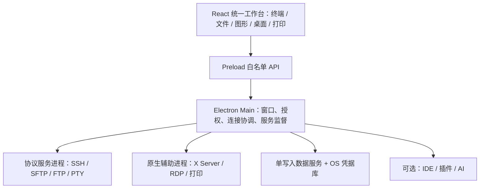

# Hornet Remote Suite 软件详细设计说明书 V1.0
## 第1章 系统总体设计

修订日期：2026-09-24。状态：设计修订稿，尚未通过实现验收。文档版本 V1.0 不代表软件已经达到 V1.0。总目录、来源和评审问题见 [docs 导读](README.md)。

## 1.1 产品目标与边界

构建一个统一桌面工作台，覆盖 Xmanager Power Suite 8 的四类核心用途：终端连接、文件传输、远程图形应用/桌面、远程打印。用户在同一个产品内管理主机、认证资料、标签、后台任务及审计，不需要维护四套连接配置。

Power Suite 的组成以 [NetSarang 官方产品信息](https://sales.netsarang.com/e_sales/online_store.html?open=xfp) 为依据。具体功能与已知差异见第24章；不能把 SSH + SFTP MVP 宣称为完整替代。Remote IDE、Git、AI、插件和企业平台为增量能力，不能代替图形与打印模块。

“集合到一起”指统一安装、入口、配置、交互和生命周期；允许协议引擎在独立进程运行。X11 多窗口应用可使用原生顶层窗口，但必须能从工作台定位、关闭和查看状态；RDP/VNC 的完整集成目标是工作台内视图。外部程序启动器只能算原型。

## 1.2 功能基线

| 需求ID | 功能域 | 必须交付的能力 | 责任章节 |
|---|---|---|---|
| HRS-UNI | 统一工作台 | 主机/连接配置、认证配置、分组搜索、混合标签、布局恢复、任务中心、配置导入导出 | 2、11、24 |
| HRS-SSH | 安全连接 | SSH2、主机密钥、密钥/密码/交互认证、Agent、跳板链、代理、隧道 | 5、15 |
| HRS-TERM | 终端 | SSH/本地/串口/Telnet、多标签分屏、编码、快捷命令、广播、脚本、日志 | 6 |
| HRS-FILE | 文件管理 | SFTP/FTP、队列、续传、同步预览、远程编辑、权限、调度 | 7 |
| HRS-X11 | 图形应用 | 本地 X Server、SSH X11 转发、Xstart 类启动配置、XDMCP | 21 |
| HRS-DESK | 远程桌面 | 集成 RDP/VNC、输入、缩放、剪贴板策略、重连 | 22 |
| HRS-PRINT | 远程打印 | LPD 接收、队列映射、本地打印、作业查询/取消/重打 | 23 |
| HRS-SEC | 安全与运维 | 凭据库、进程隔离、签名更新、备份迁移、脱敏日志 | 3、4、13—15 |
| HRS-EXT | 扩展 | 远程 IDE、插件、AI、企业服务 | 8—10、16—17 |

完整对标还包括终端仿真、认证扩展、X 扩展和打印格式的细项；第24章逐项标注候选实现、后续兼容或明确差异。未验收的项目不能标“支持”。

## 1.3 交付阶段与平台

- M0：架构与原生引擎验证；验证嵌入式图形、X11 转发、打印闭环及分发条件。
- M1：SSH/SFTP 统一工作台 MVP（软件 0.x），共享模型、安全和恢复机制必须先完成。
- M2：桌面套件 V1.0 候选，纳入终端增强、FTP、X11、RDP/VNC、LPD，并通过第12章核心验收。
- M3：补齐第24章高级兼容项，提供逐项兼容报告；未关闭差异前不宣称“所有功能完全等价”。
- M4：Remote IDE、插件、AI 和企业能力按独立版本演进。

默认首发验证平台为 Windows 11 x64；Windows 10、Windows Server、ARM64、Linux 和 macOS 是待验证目标，不能由 Electron 跨平台直接推导为所有模块可用。发布清单必须记录 OS 具体版本、架构、协议引擎版本、功能与限制。Windows 支持范围最终取决于锁定的运行时及原生依赖。远程主机按 SSH/SFTP、X11、RDP、VNC、LPD 协议能力登记，不要求安装 Hornet Agent；Agent 仅供高级 IDE 选用。

## 1.4 系统架构



React、TypeScript、Electron、xterm.js、ssh2、SQLite 延续原技术方向。Monaco 负责编辑器；LSP/DAP 需额外桥接。C++ 用于协议/操作系统适配，不预设自研加密和所有高性能 IO。X Server、RDP、VNC 引擎必须完成 M0 选型验证，见21—22章。

## 1.5 领域模型与标识

| 对象 | 标识 | 生命周期及含义 |
|---|---|---|
| HostProfile | hostId | 持久化资产；一个主机可有多个协议端点 |
| ConnectionProfile | profileId | 持久化连接方案，含协议、端点、用户名、跳板和认证引用 |
| CredentialProfile | credentialId | 可复用认证元数据；秘密只保存在系统凭据库 |
| Connection | connectionId | 一次运行时传输连接；不写入可恢复配置 |
| Channel | channelId | shell、SFTP、exec、X11、转发等逻辑通道 |
| WorkspaceLayout | workspaceId | 工作台布局；不等同于远程代码工程 |
| View | viewId | 终端、文件、X11、桌面、编辑器或打印视图 |
| Job | taskId | 可观察、可取消的后台任务；具备领域状态 |
| RemoteProject | projectId | 可选远程代码工程，关联 profileId 与远程目录 |

禁止用一个 sessionId 同时表示上述对象。旧章节出现的 sessionId 必须按此分类迁移：配置用 profileId，实时连接用 connectionId；终端仍使用 terminalId。不同协议共享认证配置引用，不意味着可以复用同一个网络连接。

```typescript
type Protocol = "ssh" | "sftp" | "ftp" | "telnet" | "serial"
  | "local" | "x11" | "xdmcp" | "rdp" | "vnc";
interface ConnectionProfile {
  profileId: string;
  hostId?: string;
  name: string;
  protocol: Protocol;
  endpoint: { host?: string; port?: number; device?: string };
  username?: string;
  credentialId?: string;
  routeProfileIds: string[];
  options: Record<string, unknown>; // 按 protocol 做运行时 schema 校验
  revision: number;
}
interface RuntimeConnection {
  connectionId: string;
  profileId: string;
  generation: number;
  state: "connecting" | "verifying" | "authenticating" | "ready"
    | "reconnecting" | "closing" | "closed" | "failed";
}
```

打印队列是本地服务配置，不伪装成出站 ConnectionProfile。一次输入的密码通过一次性挑战应答进入凭据服务，不放入 profile.options。

## 1.6 共享连接与生命周期

ConnectionCoordinator 唯一负责分配连接及租约。SSH 复用键包含主机端点、用户名、认证引用和版本、跳板链、代理、主机信任策略；不同安全上下文禁止复用。默认每连接最多8个活跃 channel，超限排队或建立另一条符合策略的连接。

每个终端、文件任务、X11 和隧道持有独立 leaseId。关闭标签释放对应租约，不能直接断开整条 SSH。最后一个租约释放后空闲60秒再关闭；用户“断开主机”先列出受影响视图与任务，再显式终止。传输任务的租约不依赖文件面板是否打开。

断线使旧 channel 全部失效；重连增加 generation。配置/布局恢复、传输续传和 tmux 会话恢复是三件不同的事。不能重放用户输入、exec 命令或打印提交。原 SSH shell 不保证继续存在。

## 1.7 统一用户流程

1. 新建主机，保存协议配置与认证引用。
2. 连接前进行主机/证书校验，认证完成后打开指定视图。
3. 在同一主机打开终端与文件；符合复用条件时共享 SSH，不再次索要同一凭据。
4. 从文件面板打开编辑器或发起图形程序；任务中心显示进度和关联主机。
5. 切换 RDP/VNC 复用主机资料，但独立建立对应协议连接。
6. 打印中心管理本地 LPD 队列；接收的来源主机信息不可直接当作可信登录身份。
7. 退出时选择等待任务、取消任务或明确启用的后台模式；保存布局和可恢复检查点。

## 1.8 非功能与异常约束

性能是待测目标，测试环境和统计方法以第12章为准：启动 p95 ≤3秒、受控局域网 SSH 就绪 p95 ≤2秒、终端本地输入处理 p95 ≤50ms。不能保证公网认证和 MFA 在2秒内完成。

所有长任务提供 taskId、阶段、已处理字节、可取消标记、错误码；磁盘不足、主机密钥改变、认证失败不得无休止重试。服务崩溃只影响所属资源；主进程重启不能伪造会话仍在线。离线使用核心套件不依赖云账号、AI 或企业服务器。

## 1.9 文档契约

第4章为 IPC 唯一契约，第11章为持久化模型唯一基线，第12章定义发布验收，第18章定义里程碑，第24章定义对标差异。第3、5—10章保留的局部示例是伪代码，必须遵守这些共同契约；不允许从示例生成另一套数据库或 API。

## 1.10 章节导航

完整24章目录见 [README](README.md)。新增21章 X11、22章 RDP/VNC、23章 LPD、24章功能覆盖矩阵。第19章记录仍需验证的技术决策，而非“设计已完成”的结论。
